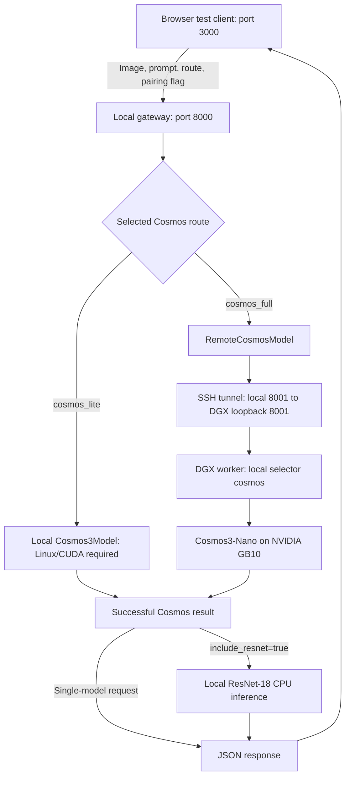

# Technical Report: Cosmos Model Switching and DGX Inference Routing

**Project:** VyFlare  
**Branch:** `cosmos_switch_function`  
**Date:** October 26, 2026  
**Reviewed repository revision:** `79df43c`  
**Scope:** Cosmos route selection, paired inference integration, and the supporting DGX worker.

## 1. Purpose and Scope

This branch extends the image-inference backend so a browser can select where Cosmos inference executes without changing the browser's API endpoint. The requested design supports a local Cosmos Lite route and a Cosmos Full route hosted on a DGX Spark. The workflow also supports running ResNet-18 alongside whichever Cosmos route is selected for the same photo.

The switch was created to separate the user-facing model choice from the execution environment. The laptop can serve the interface and execute CPU classification while the DGX supplies the NVIDIA GPU required by the current Cosmos adapter. This avoids installing Cosmos weights on the laptop for remote inference and provides explicit failure reporting when remote compute is unavailable.

This report covers only the switching implementation and its supporting integration. Recorded-video preparation, batch observations, dataset evaluation, and ResNet training are outside its scope. The existing [Cosmos and backend report](cosmos-and-backend-report.md) is a separate document and was not modified.

## 2. Implemented Routes and Their Meaning

The model registry resolves the multipart request's `model` field to an adapter:

| Request selector | Adapter | Execution destination | Current status |
|---|---|---|---|
| `cosmos_lite` | `Cosmos3Model` | Same machine as the gateway | Implemented; route behavior tested with controlled adapters; real local execution not validated on this laptop |
| `cosmos_full` | `RemoteCosmosModel` | Configured HTTP worker, reached through an SSH tunnel to the DGX | Real DGX inference and paired laptop/DGX execution verified during this implementation |
| `cosmos` | `Cosmos3Model` | Local to the process receiving the request | Legacy local selector and the deployed DGX worker's selector |
| `resnet18` | `ResNet18Model` | Gateway machine | Existing baseline retained; also available in paired requests |

**Lite and Full currently identify execution routes, not separately validated model sizes.** The local adapter defaults to Cosmos3-Nano, and the deployed DGX worker also uses Cosmos3-Nano. No separate larger Full checkpoint or specially reduced Lite checkpoint was created by this work. A different checkpoint must be compatible with the Framework reasoner interface or require an adapter change.

The laptop inspected during implementation has an Intel UHD Graphics 620 GPU and 8 GB of RAM, with no NVIDIA GPU detected. Its verified configuration enables `resnet18,cosmos_full`. The current local Cosmos adapter requires Linux/CUDA; WSL2 alone would not supply the missing NVIDIA hardware. The frontend still displays Lite, so selecting it when disabled returns a validation error rather than enabling it automatically.

## 3. Architecture and Request Flow



Selection is per request; there is no mutable global model switch shared by clients. Enabled adapters load once when the application starts. Selecting a route chooses an existing adapter rather than loading a new checkpoint for every photo.

For Full, the gateway validates the upload, applies EXIF orientation, converts it to RGB, and bounds its dimensions to 1280 by 1280. The remote adapter re-encodes that image as JPEG and forwards it with the prompt and a newly generated worker frame ID. The worker receives `model=cosmos`, runs its persistent local pipeline, and returns the result. The gateway validates the response and echoes the original browser frame ID, preserving client-side request correlation.

The gateway and worker have separate inference locks. Each process accepts one inference at a time; additional requests receive HTTP 429 instead of an unbounded queue. In a paired request, Cosmos executes first, followed by local ResNet under the gateway's same lock. If either stage fails, the request returns an error without partial paired outputs. The two outputs are separate observations; the implementation does not fuse predictions or use ResNet output as the Cosmos prompt.

## 4. Frontend and API Contract

The included HTML/JavaScript test client offers three choices:

- ResNet-18 + Cosmos Lite (local).
- ResNet-18 + Cosmos Full (DGX Spark).
- ResNet-18 only.

For a Cosmos choice, the frontend submits `include_resnet=true`. Existing clients that omit this field retain single-model behavior. Changing the selection increments a session counter so an older in-flight result is not displayed under a newer selection. The client permits one outstanding request and targets a five-second capture interval for Cosmos, skipping captures while busy. This interval is scheduling behavior, not a guarantee of five-second inference.

`POST /predict` accepts multipart form data:

| Field | Purpose |
|---|---|
| `image` | JPEG or PNG photo |
| `frame_id` | Required browser request identifier, at most 128 characters |
| `model` | Enabled registry selector, such as `cosmos_full` |
| `include_resnet` | `true` or `false`; requests paired inference when the selected model is not ResNet |
| `prompt` | Optional Cosmos instruction; defaults to a brief scene description, with a 1–2000-character validation bound |

A paired response contains `frame_id`, `mode`, `model`, `inference_ms`, `result`, and `results`. `result` preserves the selected Cosmos output for compatibility. `results.cosmos_full` or `results.cosmos_lite` contains that Cosmos output, while `results.resnet18` contains the classification output. The duplicate Cosmos payload is intentional.

`inference_ms` measures the gateway's inference section after initial image preprocessing. In paired mode, it includes the remote call and local ResNet stage; it is not a pure GPU execution benchmark or complete browser round-trip measurement.

## 5. Configuration and Deployment

### Laptop gateway

The verified configuration for local ResNet and remote Cosmos is:

```dotenv
PORT=8000
CORS_ORIGINS=http://localhost:3000,http://127.0.0.1:3000
MODEL_MODE=real
ENABLED_MODELS=resnet18,cosmos_full
RESNET_DEVICE=cpu
COSMOS_FULL_URL=http://127.0.0.1:8001/predict
COSMOS_FULL_REMOTE_MODEL=cosmos
COSMOS_FULL_TIMEOUT_SECONDS=120
```

`MODEL_MODE=mock` instead creates transport-test adapters, including a mock Full adapter that does not contact the DGX. Such responses explicitly state that no model inference occurred. Real mode does not silently substitute mock results.

### DGX worker

The worker was deployed separately at:

```text
/home/yt-vyflare71b7/workspace/vial-baseline/cosmos-api-worker
```

Its deployed configuration is:

```dotenv
PORT=8001
MODEL_MODE=real
ENABLED_MODELS=cosmos
COSMOS_CHECKPOINT=Cosmos3-Nano
COSMOS_MAX_NEW_TOKENS=128
```

Using only `cosmos` on the worker avoids recursive remote forwarding and avoids loading ResNet there. The worker uses the existing Cosmos Framework environment and cached model files. The [DGX launcher](backend/dgx/start-worker.sh) selects that environment, sets the Hugging Face cache location, matches the working CUDA library setup, preloads the required NPP libraries, and launches the API from the Framework directory.

The worker was started in the background and can outlive the interactive SSH session. It is not installed as an automatically restarting system service. GPU memory remains occupied while its pipeline is loaded. Current reachability must be checked with health; the historical verification results below are not a live availability guarantee.

### SSH transport and readiness

The laptop reaches the worker using:

```powershell
ssh -N -o ExitOnForwardFailure=yes -L 8001:127.0.0.1:8001 yt-vyflare71b7@172.30.102.122
```

The worker binds to loopback; no public inference listener is configured. The tunnel must remain open during requests. A successful SSH connection does not start the model service.

Gateway health is available on port 8000, while worker health is available through the tunnel on port 8001. A worker response showing `status=ready`, `mode=real`, and `models=[cosmos]` establishes that initialization completed. It does not replace a successful inference test. The gateway's health endpoint does not probe the DGX.

Detailed startup commands are maintained in [the DGX startup guide](backend/dgx/README.md).

## 6. Result Validation and Failure Behavior

The remote adapter rejects mismatched frame IDs, unexpected worker selectors, non-real mode, mock results, missing text, and malformed response structures. It also requires worker-reported execution metadata identifying Linux, `aarch64`, and `NVIDIA GB10`. Successful Cosmos results expose the worker hostname and GPU for troubleshooting.

These fields are configuration checks, not cryptographic hardware attestation. The trusted SSH destination establishes which machine is contacted; a configurable HTTP URL and self-reported metadata alone do not prove physical identity. Full never loads Cosmos weights locally and has no fallback to Lite or mock inference.

| Condition | Response behavior |
|---|---|
| Unknown/disabled route, invalid fields, or missing ResNet for pairing | HTTP 400 |
| Upload or pixel limit exceeded | HTTP 413 |
| Unsupported image format | HTTP 415 |
| Explicit safety rejection | HTTP 422 |
| Busy gateway or worker | HTTP 429, with `Retry-After` |
| Worker HTTP failure, invalid response, mock result, or incompatible execution metadata | HTTP 502 |
| Connection failure reported as an unavailable worker | HTTP 503 |
| Remote timeout | HTTP 504 |
| Local model/runtime failure or unexpected exception | HTTP 500 |

The API limits uploads to 5 MiB and images to 16 million pixels. A compatibility fix preserves the explicit pixel bound even when Framework imports set Pillow's global limit to `None`.

Some tunnel connection closures surface as an invalid-response error rather than an unavailable-worker error because the adapter handles general I/O errors separately from URL connection errors. A timeout releases the gateway lock but does not cancel computation already running on the DGX; the worker can remain busy afterward.

## 7. Safety Coverage Relevant to Switching

The same Cosmos adapter is used for local execution and on the DGX worker. It checks the prompt, invokes the Framework's visual runner and postprocessing, generates reasoner text, and checks the output. Temporary image and sample files are removed after each request.

The installed Framework release disables its image content classifier, with source comments citing excessive false positives. Its visual runner still provides face-blurring postprocessing. Responses therefore explicitly report `input_image=disabled_in_framework_release`, together with `image_postprocessing=completed`, instead of claiming image content approval.

The adapter directly invokes native text classification where available because the installed Framework's convenience method can treat classifier errors as safe. Only a native `Safe` label passes this adapter; `Unsafe` and `Controversial` labels are rejected. Classifier exceptions propagate as errors rather than returning successful inference results.

These content checks do not establish correctness of vial inspection, label identification, or defect judgments. Content screening and model task accuracy are separate concerns.

## 8. Verification Results

### Automated application tests

During preparation of this report, the following command completed successfully:

```powershell
cd backend
.\.venv\Scripts\python.exe -m unittest discover -s tests -q
```

**Result: 26 tests passed.** The suite covers route selection, local versus remote dispatch, single-model and paired requests, missing-model validation, response correlation, busy handling, timeout/unavailable behavior, rejection of mock or incompatible workers, recovery after failures, the Pillow compatibility fix, and native text-classifier behavior. The suite uses controlled adapters and local test HTTP workers; it does not load Cosmos weights or measure real-model accuracy.

### Real execution evidence from this implementation

| Verification | Observed result | What it establishes |
|---|---|---|
| DGX worker health | Real mode, `cosmos` enabled, ready | Worker initialized successfully |
| Synthetic vial image sent directly to worker | HTTP 200; “A blue liquid in a glass container.”; approximately 15.9 seconds | Real photo request executed through the DGX API |
| Laptop gateway with temporary SSH tunnel and paired inference | HTTP 200; both `resnet18` and `cosmos_full`; approximately 13.0 seconds | Local classification and remote Cosmos work together through the route |
| Subsequent user frontend upload | Both outputs returned; Cosmos text “Two test tubes with labels on them.”; `inference_ms=13691.9` | Browser-to-gateway-to-DGX integration operated successfully |

The real Cosmos responses reported hostname `vyflare71b7`, Linux/aarch64, and NVIDIA GB10. These observations were recorded earlier in this implementation session; real inference was not rerun specifically to write this report. The timings are individual observations, not a latency distribution, throughput guarantee, or accuracy benchmark.

## 9. Delivered Files and Remaining Work

| Repository file | Switching-related responsibility |
|---|---|
| [backend/models.py](backend/models.py) | Route registry, remote transport, response/hardware metadata checks, Cosmos execution adapter |
| [backend/app.py](backend/app.py) | Selector validation, paired inference, concurrency gate, upload checks, error mapping |
| [backend/frontend/index.html](backend/frontend/index.html) | Test-client route dropdown |
| [backend/frontend/app.js](backend/frontend/app.js) | Per-request route/pairing fields, capture scheduling, stale-result handling |
| [backend/.env.example](backend/.env.example) | Gateway and remote-worker configuration examples |
| [backend/dgx/start-worker.sh](backend/dgx/start-worker.sh) | DGX runtime and library configuration |
| [backend/dgx/README.md](backend/dgx/README.md) and [backend/README.md](backend/README.md) | Deployment, startup, and API guidance |
| [backend/tests/test_api.py](backend/tests/test_api.py) and [backend/tests/test_cosmos_switch.py](backend/tests/test_cosmos_switch.py) | Automated API and routing verification |

The implemented and verified arrangement is local CPU ResNet plus remote Cosmos3-Nano on the DGX. Remaining work includes selecting and validating genuinely different Lite/Full checkpoints if needed, providing a supported local runtime for Lite on suitable hardware, reflecting enabled routes in the dropdown, and adding managed worker restart/monitoring if persistent service operation is required. These are not completed features of the current switch.

The implementation establishes selectable execution destinations and a working paired request path. It does not establish production service availability or inspection accuracy.
