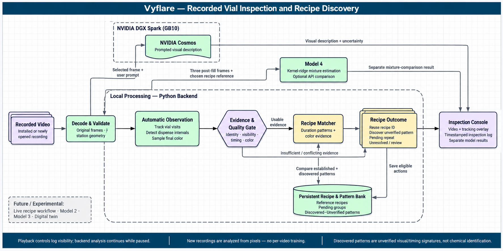

# Recorded Inspection Data Pipeline

The diagram follows the implemented recorded-video workflow. Original frames
feed automatic vial/dispense/color observation, quality checks and the recipe
matcher. Eligible actions update the persistent reference/pattern bank and
source-timestamped outcomes appear in the inspection log. Playback controls log
visibility; background analysis continues while paused.

NVIDIA Cosmos runs on the DGX Spark worker as separate prompted visual analysis.
Model 4 provides optional kernel-ridge mixture comparison through the API; it is
not required by the automatic recipe matcher or mounted as the main inspection
form. Model 2 remains experimental and outside automatic recipe decisions.
Live recipe automation, Model 3's workflow role and digital-twin work are deferred.

New recordings must use the supported station geometry and native decoder.
Discovered recipes are unverified timing/appearance patterns, not identification
of chemical ingredients. See [implementation and deployment limits](../../backend/recipes/automatic_recordings.md).

This reference-style illustration was generated with the built-in imagegen tool.
